# Disk Analysis & Autopsy — TryHackMe Technical Walkthrough

> **Professional Digital Forensics Documentation**  
> Author: **Anurag Revankar**  
> Platform: **TryHackMe**  
> Room: **Disk Analysis & Autopsy**  
> Difficulty: **Medium**  
> Forensic Tool: **Autopsy 4.18.0**  
> Evidence: **HASAN2.E01**  
> Environment: **Authorized Training Lab**

---

## Executive Summary

This report documents the examination of the `HASAN2.E01` forensic image using Autopsy 4.18.0. The analysis identifies the Windows host, enumerates user accounts, reconstructs network configuration, examines browser and wallpaper artifacts, and reviews endpoint activity associated with PowerShell and password-focused utilities.

The investigation demonstrates the value of correlating artifacts across multiple Windows evidence sources. The DHCP address shown in a registry interface key was `0.0.0.0`, so the system's usable IPv4 address was identified in the `Look@LAN` INI configuration. The associated MAC-like value was also recovered from this configuration, while the network adapter model was found under the SOFTWARE registry hive's `NetworkCards` key.

User-related artifacts were examined through Autopsy's Operating System User Account results, profile `NTUSER.DAT` hives, desktop contents, and PowerShell PSReadLine history. Windows Defender DetectionHistory provided an additional lead for a second password-oriented tool. The YARA file search and keyword search for `zerologon` extended the analysis into rule metadata and deleted-file context.

The room contains two flag values in the source evidence. Both are redacted in this public report and in the copied screenshots.

> **Evidence handling note:** This write-up uses the values displayed in the supplied screenshots and source notes. It does not claim an independent re-acquisition of the E01 image, recomputation of its hash, or validation against a separate forensic copy.

## Table of Contents

1. [Case Overview](#1-case-overview)
2. [Evidence Integrity and Image Metadata](#2-evidence-integrity-and-image-metadata)
3. [Operating System and Host Identification](#3-operating-system-and-host-identification)
4. [User Account Enumeration](#4-user-account-enumeration)
5. [Last Accessed User](#5-last-accessed-user)
6. [Network Configuration Analysis](#6-network-configuration-analysis)
7. [Network Adapter Identification](#7-network-adapter-identification)
8. [Installed Network Monitoring Software](#8-installed-network-monitoring-software)
9. [Browser Bookmark Analysis](#9-browser-bookmark-analysis)
10. [User Wallpaper Attribution](#10-user-wallpaper-attribution)
11. [Desktop File and PowerShell History](#11-desktop-file-and-powershell-history)
12. [PowerShell Script Analysis](#12-powershell-script-analysis)
13. [Password Tool Artifact Discovery](#13-password-tool-artifact-discovery)
14. [YARA Rule Inspection](#14-yara-rule-inspection)
15. [Deleted Zerologon Archive Discovery](#15-deleted-zerologon-archive-discovery)
16. [Consolidated Findings](#16-consolidated-findings)
17. [Forensic Observations and Limitations](#17-forensic-observations-and-limitations)
18. [Defensive Recommendations](#18-defensive-recommendations)
19. [Lessons Learned](#19-lessons-learned)
20. [Conclusion](#20-conclusion)

---

# 1. Case Overview

| Property | Value |
| --- | --- |
| Platform | TryHackMe |
| Room | Disk Analysis & Autopsy |
| Difficulty | Medium |
| Evidence file | `HASAN2.E01` |
| Evidence format | EnCase Evidence File (E01) |
| Forensic tool | Autopsy 4.18.0 |
| Operating system | Windows 10 20H1 |
| Host name | `DESKTOP-0R59DJ3` |
| Acquisition date shown | 8 February 2021, 12:40:23 |
| Time zone shown | America/New_York |
| Objective | Inspect disk artifacts and answer fifteen forensic questions |

## Scope

The analysis focuses on artifacts visible in the provided Autopsy screenshots and the supplied challenge notes:

- E01 container metadata and image hashes.
- Operating-system and user-account artifacts.
- Windows registry hives.
- Look@LAN program files and configuration.
- Browser bookmarks.
- User profile wallpaper settings and referenced image files.
- Desktop files and PowerShell command history.
- Downloaded password-tool archives.
- Windows Defender detection history.
- YARA file search and rule content.
- Keyword-search evidence for a Zerologon archive.

No live endpoint, network service, or external system was accessed as part of this offline artifact review.

---

# 2. Evidence Integrity and Image Metadata

## Objective

Record the forensic container metadata displayed by Autopsy and capture the image hash supplied by the evidence view.

## Action — Review the E01 Container Summary

The source image was selected under **Data Sources**, and the **Summary → Container** view was examined.

<p align="center">
  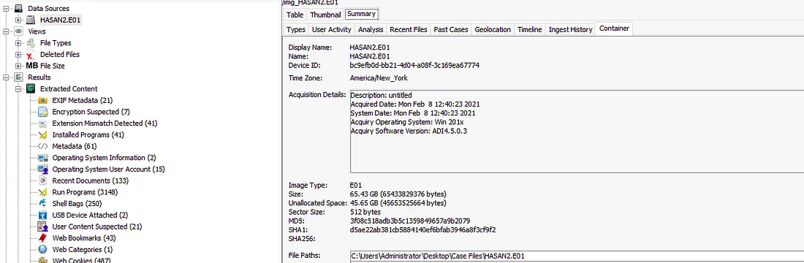
</p>

<p align="center">
  <b>Figure 1.</b> E01 container summary with acquisition metadata and hash fields.
</p>

## Observed Metadata

| Attribute | Displayed value |
| --- | --- |
| Display name | `HASAN2.E01` |
| Image type | `E01` |
| Image size | `65.43 GB` (`65,434,382,976 bytes`) |
| Unallocated space | `45.65 GB` (`45,653,552,664 bytes`) |
| Sector size | `512 bytes` |
| Acquisition date | Monday, 8 February 2021, 12:40:23 |
| System date | Monday, 8 February 2021, 12:40:23 |
| Time zone | `America/New_York` |
| Acquisition OS | `Win 20ix` (as visibly rendered in the summary) |
| Acquisition software | `AD1 4.5.0.3` (as visibly rendered in the summary) |
| MD5 | `3f08c518adb3b5c1359849657a9b2079` |

The summary also displays SHA-1 and SHA-256 hash fields. The MD5 value is the value required by the room question and is reproduced above.

## Interpretation

The container summary provides the image format, size, unallocated-space figure, sector size, acquisition timestamps, time-zone setting, and hash metadata. These values are part of the initial evidence review and should be recorded before deeper artifact analysis.

The screenshot is a view of Autopsy's summary metadata; it is not an independent hash calculation performed during this documentation task. In a formal investigation, the hash should be independently verified at acquisition and again after evidence transfer or processing.

---

# 3. Operating System and Host Identification

## Objective

Determine the host name and Windows platform recorded in the extracted operating-system information.

## Action — Examine Operating System Information

In Autopsy, navigate to:

`Results → Extracted Content → Operating System Information`

<p align="center">
  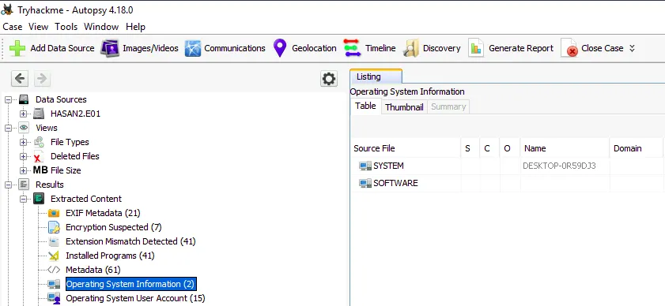
</p>

<p align="center">
  <b>Figure 2.</b> Operating System Information extracted from the SYSTEM and SOFTWARE registry hives.
</p>

## Observed Result

The operating-system information view identifies the computer name as:

```text
DESKTOP-0R59DJ3
```

The acquisition summary identifies the operating-system context as **Windows 10 20H1**.

## Interpretation

Autopsy extracted operating-system information from the Windows registry hives. The host name is an endpoint identifier that can be correlated with other artifacts, including network configuration, user profiles, and application records.

---

# 4. User Account Enumeration

## Objective

Identify the human user accounts present in the Windows installation and distinguish them from built-in service or guest accounts.

## Action — Review Operating System User Account Results

Navigate to:

`Results → Extracted Content → Operating System User Account`

<p align="center">
  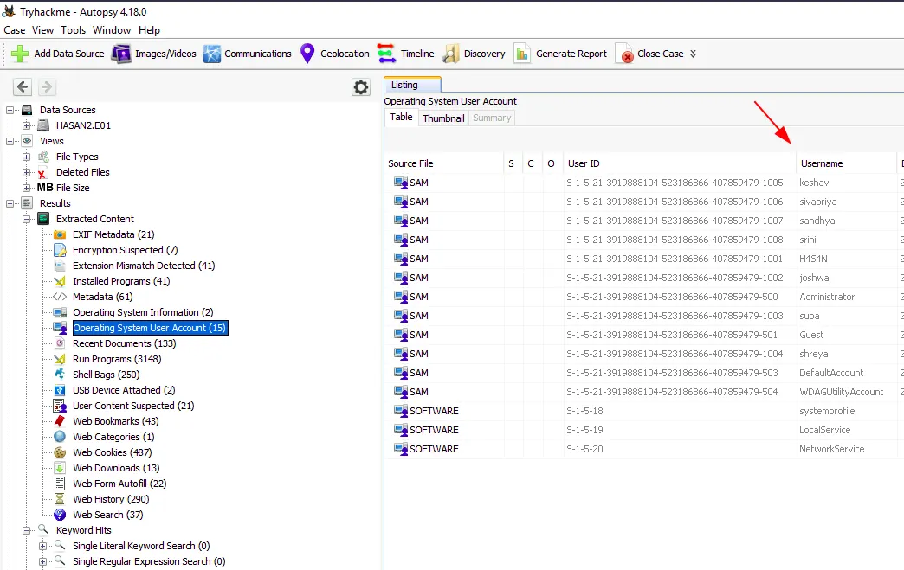
</p>

<p align="center">
  <b>Figure 3.</b> User account artifacts extracted from SAM and SOFTWARE registry sources.
</p>

## Observed Result

The source notes distinguish eight human user accounts from system and built-in accounts. The human account names, in alphabetical order, are:

```text
H4S4N
joshwa
keshav
sandhya
shreya
sivapriya
srini
suba
```

The Autopsy table also includes non-human or built-in identities such as `Administrator`, `Guest`, `DefaultAccount`, `LocalService`, `NetworkService`, `systemprofile`, and `WDAGUtilityAccount`. These are not included in the requested human-user list.

## Interpretation

The account results are derived from Windows account-related registry data. Filtering out built-in and service identities is important when the question asks specifically for the users associated with the system rather than every account-like entry recovered by the parser.

---

# 5. Last Accessed User

## Objective

Determine which human account has the most recent value in Autopsy's **Date Accessed** column.

## Action — Sort the User Account Results

In the Operating System User Account table, sort the **Date Accessed** column in descending order.

<p align="center">
  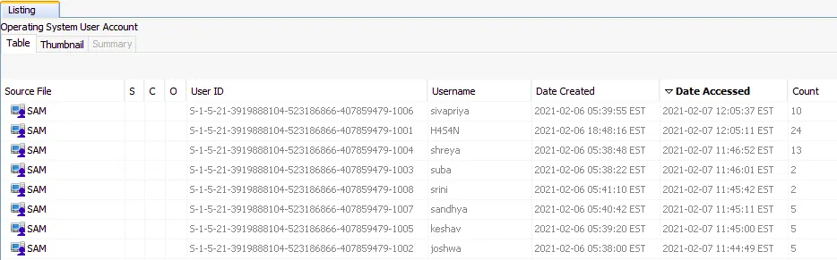
</p>

<p align="center">
  <b>Figure 4.</b> User account artifacts sorted by Date Accessed.
</p>

## Observed Result

The first row in the sorted view is:

```text
sivapriya
```

The screenshot shows the `Date Accessed` value for this account later than the other listed human users.

## Interpretation

The room's question is answered using the ordering of Autopsy's account artifact metadata. This is a parser-derived account activity field. It should not be interpreted as a complete logon timeline without corroborating event logs, registry timestamps, or other user-activity artifacts.

---

# 6. Network Configuration Analysis

## Objective

Investigate the system's IP configuration and recover a useful IPv4 address from the forensic image.

## 6.1 Registry Review

The Windows SYSTEM hive was inspected under the network-interface registry branch:

```text
SYSTEM\CurrentControlSet\Services\Tcpip\Parameters\Interfaces
```

The selected interface key shows values including:

```text
EnableDHCP       1
DhcpIPAddress    0.0.0.0
DhcpSubnetMask   255.0.0.0
DhcpServer       255.255.255.255
```

<p align="center">
  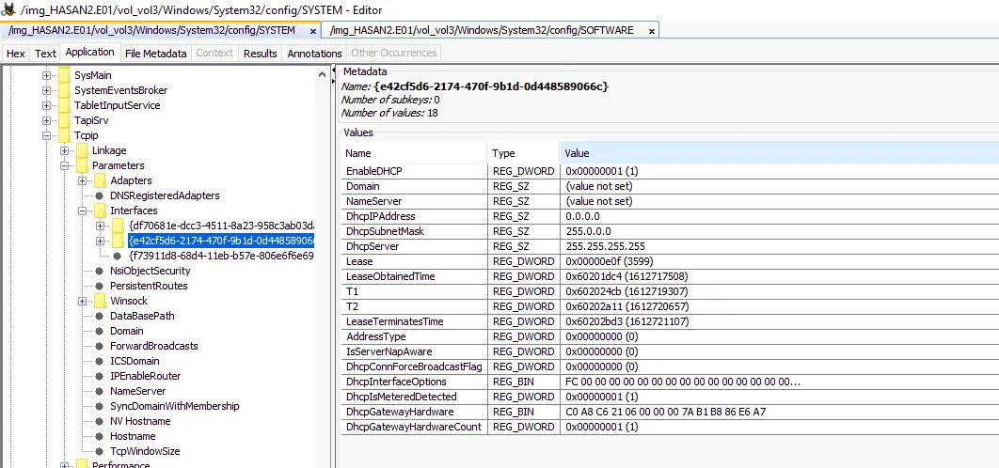
</p>

<p align="center">
  <b>Figure 5.</b> Registry network-interface values; the displayed DHCP address does not provide the required host IP.
</p>

## Interpretation

The interface's `DhcpIPAddress` value appears as `0.0.0.0` in the supplied registry view. This value is not the useful endpoint address requested by the challenge. Rather than treating it as the answer, the investigation uses another local artifact containing the network monitor's recorded configuration.

## 6.2 Look@LAN Configuration as an Alternative Source

The installed-program results contain `Look@LAN`. Its directory was examined under:

```text
Program Files (x86)\Look@LAN
```

The directory contains a configuration file named:

```text
irunin.ini
```

The Indexed Text view exposes a Variables section containing the LAN address and interface-related fields.

<p align="center">
  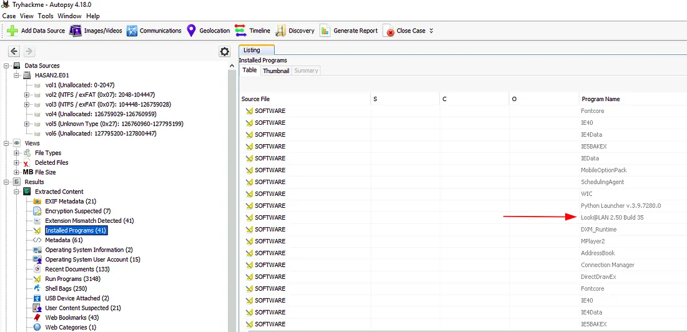
</p>

<p align="center">
  <b>Figure 6.</b> Look@LAN identified in the installed-program results.
</p>

<p align="center">
  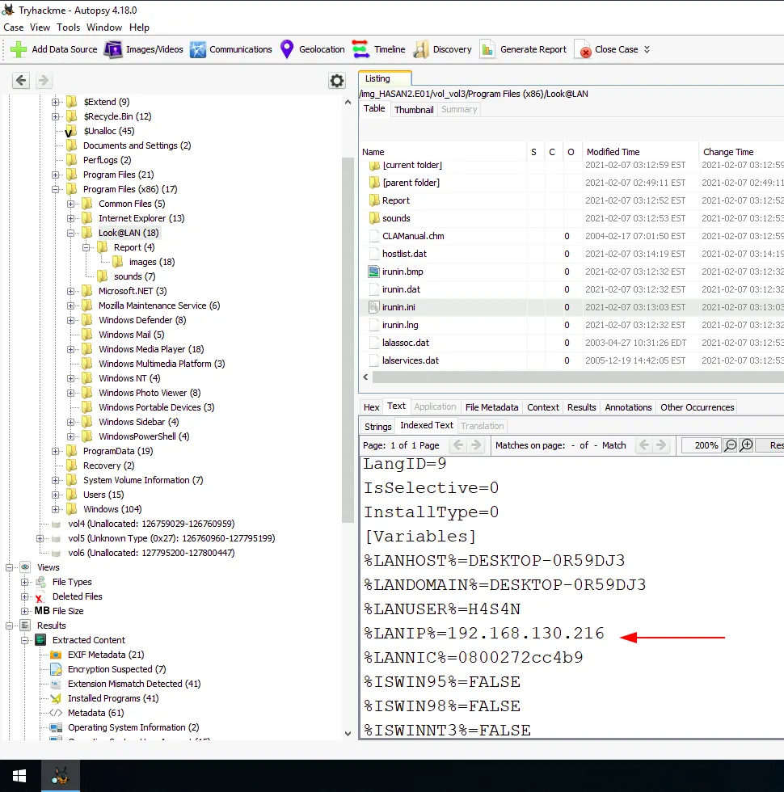
</p>

<p align="center">
  <b>Figure 7.</b> Look@LAN configuration file with the LANIP field.
</p>

## Observed Result

The configuration includes:

```text
%LANHOST%=DESKTOP-0R59DJ3
%LANDOMAIN%=DESKTOP-0R59DJ3
%LANUSER%=H4S4N
%LANIP%=192.168.130.216
%LANNIC%=0800272cc4b9
```

The address recorded in the Look@LAN configuration is:

```text
192.168.130.216
```

## Interpretation

The Look@LAN INI provides a secondary source for the host's LAN configuration. It also associates the recorded configuration with host `DESKTOP-0R59DJ3` and user context `H4S4N`.

This is an application-generated configuration artifact. It is useful corroborating evidence, but it should be described as the address recorded by Look@LAN rather than a live network measurement at the time of forensic examination.

---

# 7. Network Adapter Identification

## Objective

Recover the hardware address and the human-readable network adapter model.

## 7.1 MAC Address from Look@LAN

The `irunin.ini` file includes the field:

```text
%LANNIC%=0800272cc4b9
```

<p align="center">
  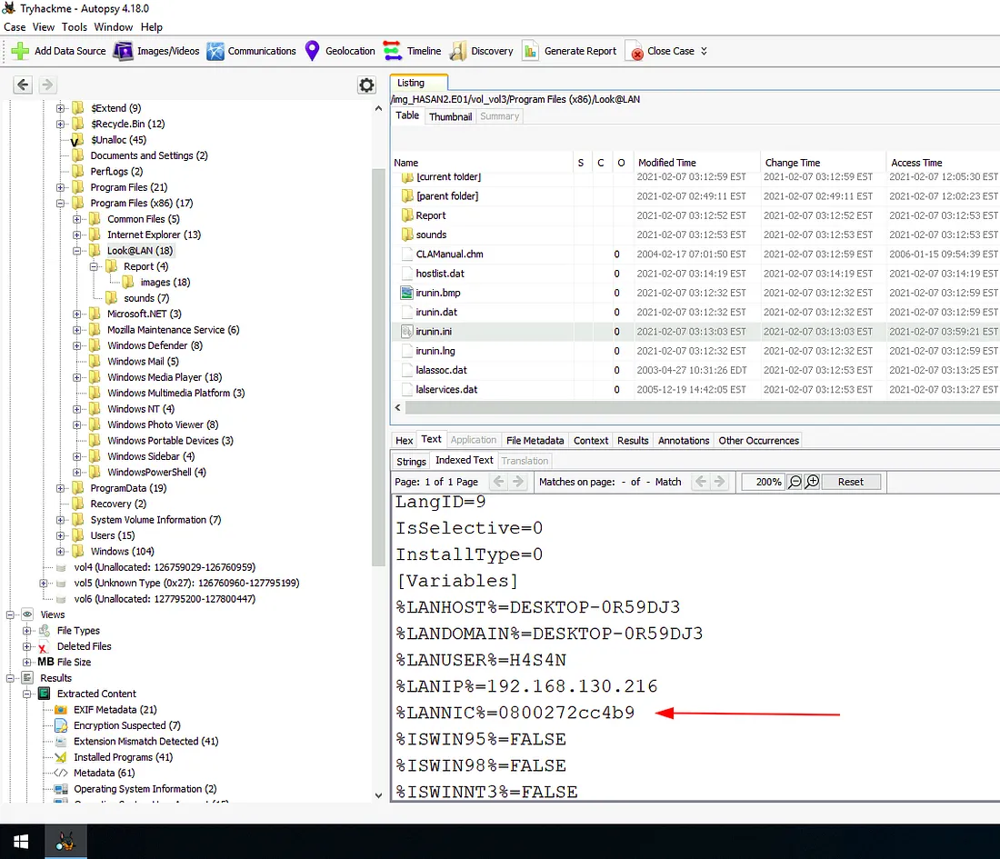
</p>

<p align="center">
  <b>Figure 8.</b> LANNIC value recovered from the Look@LAN INI artifact.
</p>

The value is formatted into the requested six-octet, hyphen-separated representation:

```text
08-00-27-2c-c4-b9
```

## 7.2 Adapter Model from the SOFTWARE Hive

The Windows SOFTWARE hive was examined at:

```text
SOFTWARE\Microsoft\Windows NT\CurrentVersion\NetworkCards
```

The selected network-card entry contains a `Description` value.

<p align="center">
  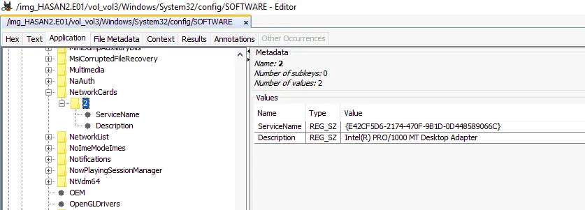
</p>

<p align="center">
  <b>Figure 9.</b> Network adapter model identified in the SOFTWARE registry hive.
</p>

## Observed Result

```text
Intel(R) PRO/1000 MT Desktop Adapter
```

## Interpretation

The hardware address and adapter description come from different evidence sources:

- The `LANNIC` value is recorded in the Look@LAN configuration.
- The adapter's descriptive model is stored under the `NetworkCards` registry branch.

The values can be reported together, but they should not be represented as if they were extracted from the same registry field.

---

# 8. Installed Network Monitoring Software

## Objective

Identify the network monitoring tool installed on the system.

## Action

The Autopsy **Installed Programs** extracted-content result was reviewed.

<p align="center">
  
</p>

## Observed Result

```text
Look@LAN
```

The investigation also identified a related program directory and INI file under `Program Files (x86)`.

## Interpretation

The installed-program artifact provides the application name. The associated INI file supplies the network configuration examined in the previous section.

---

# 9. Browser Bookmark Analysis

## Objective

Recover the coordinates embedded in a user's saved Google Maps bookmark.

## Action — Review Web Bookmarks

Navigate to:

`Results → Extracted Content → Web Bookmarks`

<p align="center">
  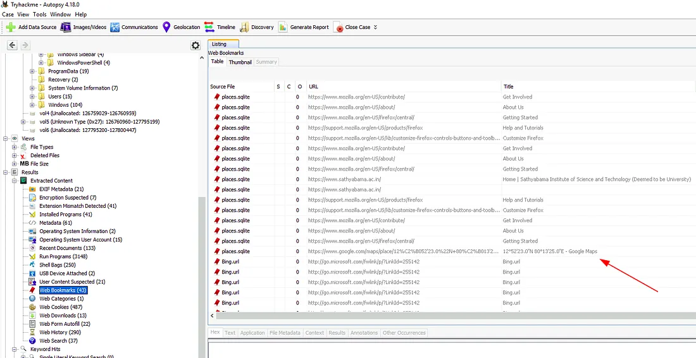
</p>

<p align="center">
  <b>Figure 10.</b> Browser bookmark artifact containing a Google Maps location URL.
</p>

## Observed Result

The Google Maps bookmark contains the coordinates:

```text
12°52'23.0"N 80°13'25.0"E
```

## Interpretation

The browser bookmark is a user-generated artifact that can reveal a saved point of interest. The coordinates are reported as they appear in the challenge source. The evidence provided does not establish why the user saved this location or whether the user physically visited it.

---

# 10. User Wallpaper Attribution

## Objective

Identify the user whose desktop wallpaper visibly contains a full name.

## Methodology

The source material uses user profile `NTUSER.DAT` data to inspect the `Desktop` personalization key and determine the file referenced by the `Wallpaper` value. The referenced image is then examined to determine whether a full name is visible.

## 10.1 H4S4N Profile Review

The H4S4N profile references a wallpaper image in the user's Downloads directory. The displayed wallpaper does not show the matching full name needed for the question.

<p align="center">
  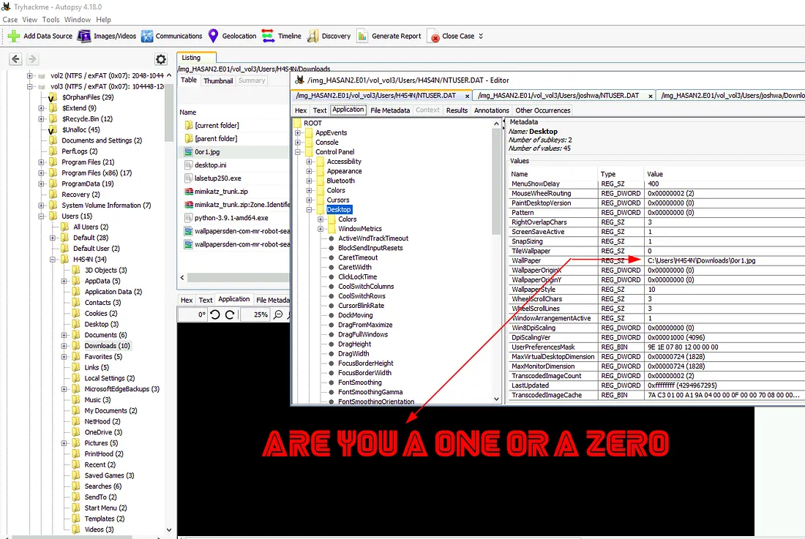
</p>

<p align="center">
  <b>Figure 11.</b> Wallpaper reference review for H4S4N; this image does not provide the requested full-name match.
</p>

## 10.2 Joshwa Profile Review

The next profile examined is `joshwa`. Its wallpaper reference points to a downloaded image that visibly contains a personal name.

<p align="center">
  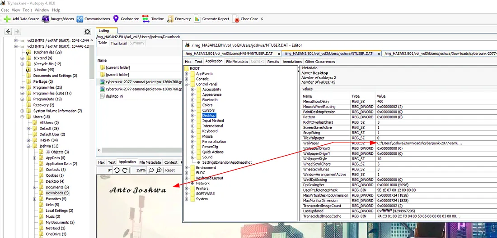
</p>

<p align="center">
  <b>Figure 12.</b> Joshwa profile wallpaper displaying the full name.
</p>

## Observed Result

```text
Anto Joshwa
```

## Interpretation

The attribution is based on the correlation between the Joshwa user's `NTUSER.DAT` wallpaper setting and the visible name in the referenced image. The H4S4N wallpaper is shown as a comparison because it did not provide the requested match.

---

# 11. Desktop File and PowerShell History

## Objective

Identify the file associated with a flag-changing action, the user profile containing it, and the command-history artifact recording the modification.

## 11.1 Identify the User's Desktop File

The `shreya` profile's Desktop directory contains:

```text
exploit.ps1
shreya.txt
```

<p align="center">
  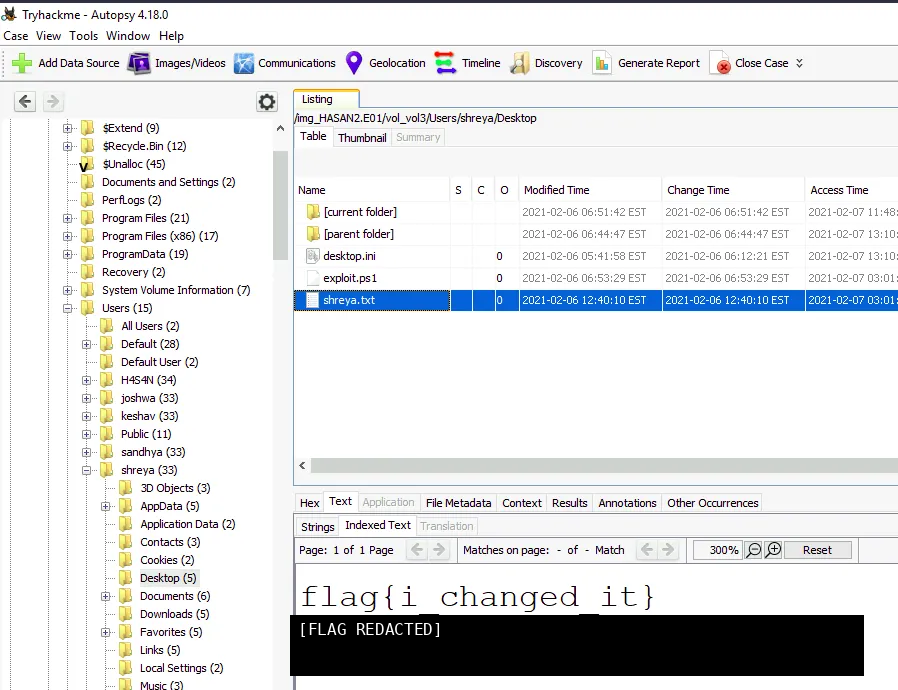
</p>

<p align="center">
  <b>Figure 13.</b> Shreya desktop artifacts. The flag string is obscured.
</p>

The presence of `shreya.txt` establishes the file involved in the question. The image copy in this repository obscures the flag text while retaining the directory listing and artifact names.

## 11.2 Locate PowerShell Command History

The source notes identify the standard PSReadLine history location under the user's roaming application data:

```text
AppData\Roaming\Microsoft\Windows\PowerShell\PSReadLine\ConsoleHost_history.txt
```

Autopsy's file-system view shows the `ConsoleHost_history.txt` artifact for the shreya profile.

<p align="center">
  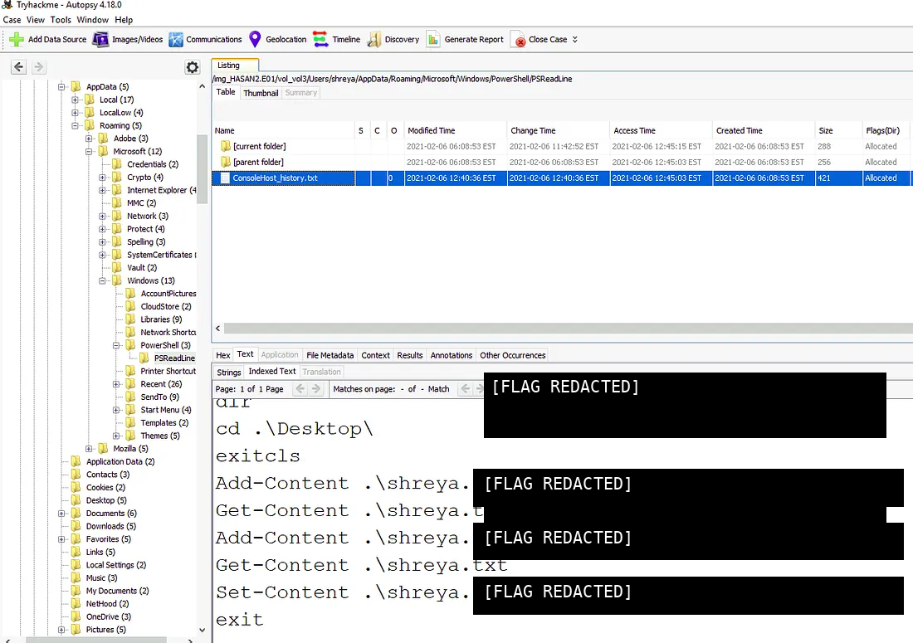
</p>

<p align="center">
  <b>Figure 14.</b> PSReadLine history with both flag strings redacted.
</p>

## Observed Activity

The visible history contains commands that:

- Change to the Desktop directory.
- List directory contents.
- Append text to `shreya.txt`.
- Read `shreya.txt`.
- Set the content of `shreya.txt` to a replacement value.
- Exit the shell.

The exact flag strings are intentionally removed from the public screenshot and are not reproduced here.

## Interpretation

PowerShell PSReadLine history records commands entered in an interactive PowerShell session. In this evidence set, it provides a direct record of file modification commands associated with `shreya.txt`.

The history is valuable for reconstructing user activity, but it is not a complete record of every PowerShell process or every script execution on the host.

---

# 12. PowerShell Script Analysis

## Objective

Inspect the PowerShell script identified alongside `shreya.txt` and document the message-writing behavior shown in the recovered file.

## Action

Open `exploit.ps1` from the shreya Desktop directory in Autopsy's content viewer.

<p align="center">
  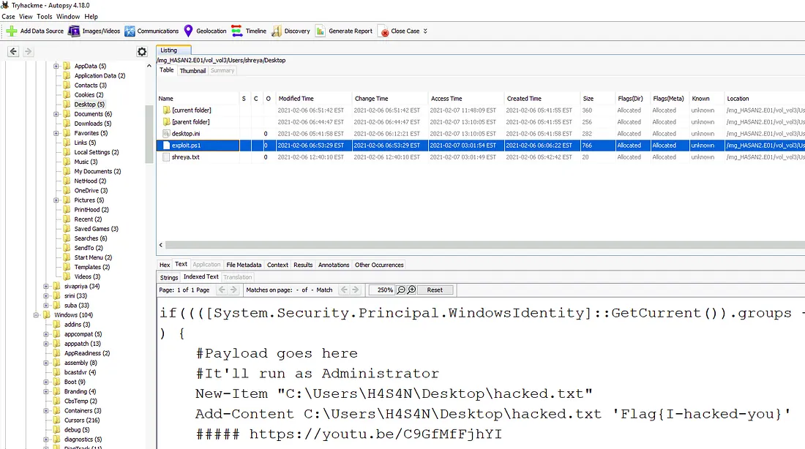
</p>

<p align="center">
  <b>Figure 15.</b> Recovered PowerShell script content.
</p>

## Observed Script Behavior

The visible excerpt shows:

- A condition that checks the current Windows identity's group membership.
- A comment indicating the payload is intended to run as Administrator.
- Creation of a file under `C:\Users\H4S4N\Desktop\hacked.txt`.
- A command that writes a message/flag-like string into that file.
- A comment containing a video reference.

The script screenshot is partially cropped and does not expose the complete script from beginning to end. This report therefore describes only the behavior visible in the supplied excerpt.

## Observed Result

The message requested by the room is redacted:

```text
[FLAG REDACTED]
```

## Interpretation

The script is evidence of a user-created PowerShell privilege-related activity and an intended write to another user's Desktop path. The visible excerpt alone does not prove that the script successfully executed with administrative privileges or that the target file was created. Corroborating execution telemetry or file-system timestamps would be needed to establish successful execution.

---

# 13. Password Tool Artifact Discovery

## Objective

Identify two password-focused security tools represented in the forensic image.

## 13.1 Mimikatz Download Artifact

The H4S4N Downloads directory contains:

```text
mimikatz_trunk.zip
```

The screenshot also shows other downloaded files, including a Python installer and an executable named `lalsetup250.exe`.

<p align="center">
  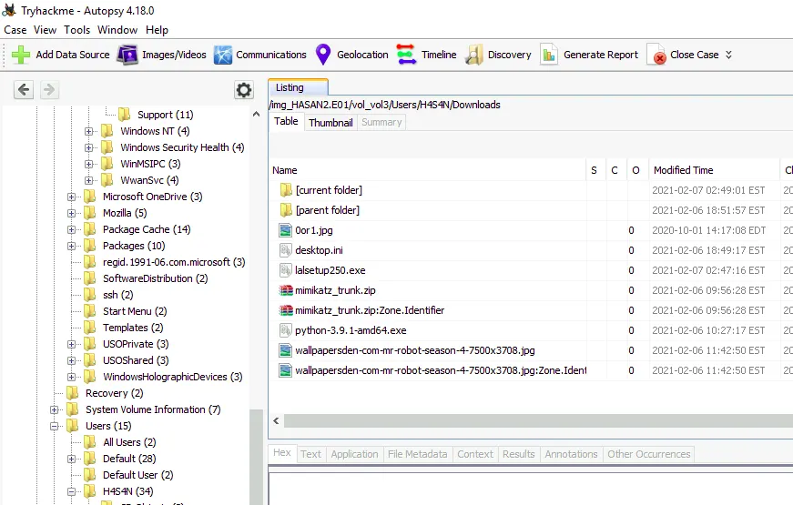
</p>

<p align="center">
  <b>Figure 16.</b> Mimikatz archive present in the H4S4N Downloads directory.
</p>

## 13.2 LaZagne Detection in Windows Defender History

The second tool was not identified from the initial Downloads listing. The source investigation reviewed Windows Defender detection history under:

```text
ProgramData\Microsoft\Windows Defender\Scans\History\Service\DetectionHistory
```

The selected detection record's Indexed Text content includes:

```text
C:\Users\H4S4N\Downloads\lazagne.exe
```

<p align="center">
  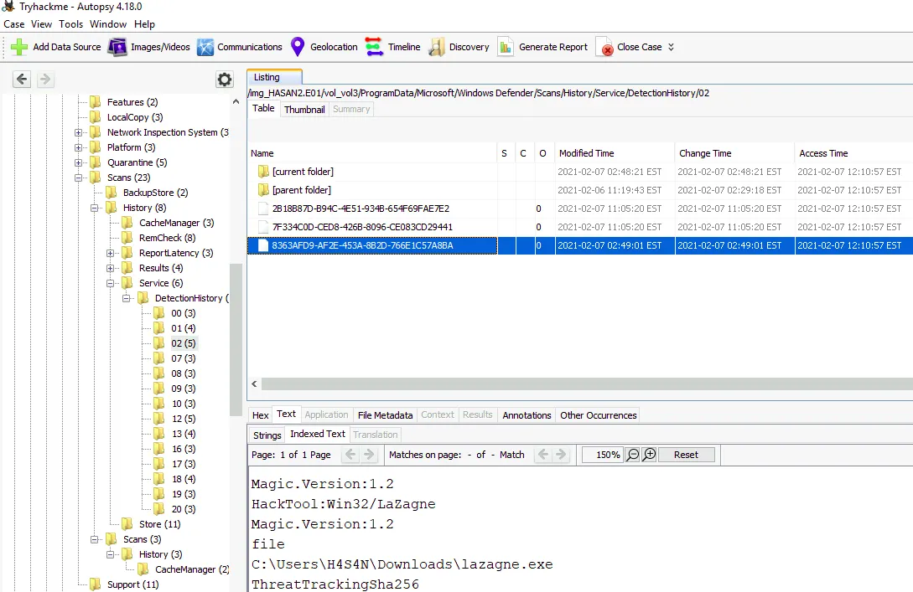
</p>

<p align="center">
  <b>Figure 17.</b> Windows Defender detection artifact referencing LaZagne.
</p>

## Observed Result

The two password-focused tools are:

```text
LaZagne
Mimikatz
```

## Interpretation

The Mimikatz result is supported by a downloaded archive in the H4S4N profile. The LaZagne result is supported by a Windows Defender detection-history record referencing `lazagne.exe`.

The screenshots establish the presence of these tool-related artifacts. They do not independently establish that either tool successfully executed or extracted credentials.

---

# 14. YARA Rule Inspection

## Objective

Locate a YARA rule file and identify the author metadata recorded inside it.

## 14.1 Search by File Attribute

Autopsy's **Tools → File Search by Attributes** dialog was used to search for file names containing:

```text
.yar
```

<p align="center">
  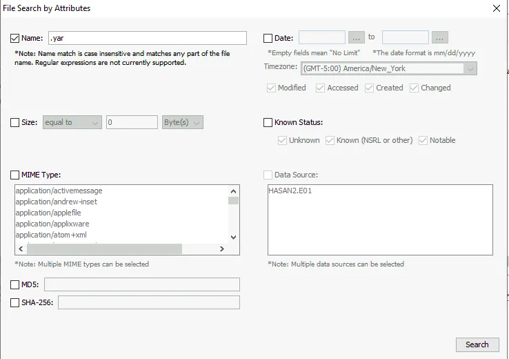
</p>

<p align="center">
  <b>Figure 18.</b> Attribute-based search for YARA rule filenames.
</p>

## 14.2 Inspect the Recovered Rule

The result list contains multiple references to a YARA file, including:

```text
kiwi_passwords.yar
```

The file content is displayed in the lower Indexed Text pane.

<p align="center">
  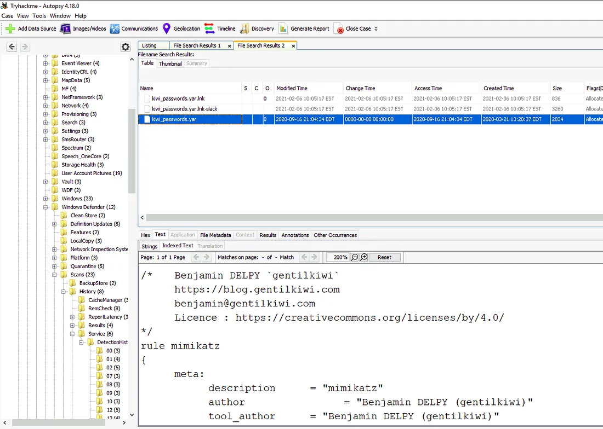
</p>

<p align="center">
  <b>Figure 19.</b> YARA rule metadata identifying its author.
</p>

## Observed Result

The file comment includes:

```text
Benjamin DELPY `gentilkiwi`
```

## Interpretation

The author field is explicit in the recovered rule content. The filename and rule name indicate a relationship to Mimikatz, but the evidence supplied here is used only to answer the author question. No claim is made that the rule was executed during the recorded user session.

---

# 15. Deleted Zerologon Archive Discovery

## Objective

Locate the archive associated with an MS-NRPC / Zerologon exploit reference.

## Action — Keyword Search

Autopsy's keyword search was used with the term:

```text
zerologon
```

<p align="center">
  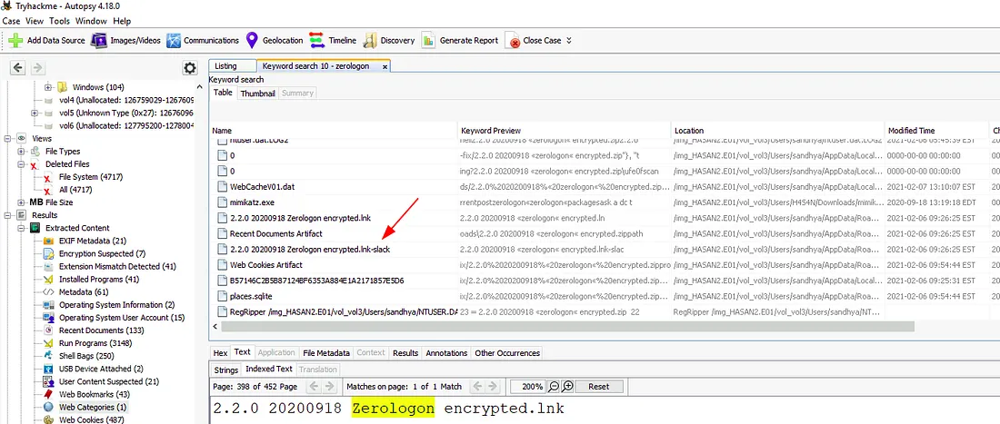
</p>

<p align="center">
  <b>Figure 20.</b> Keyword search result identifying the Zerologon archive.
</p>

## Observed Result

The search result includes the archive name:

```text
2.2.0 20200918 Zerologon encrypted.zip
```

The search view associates the artifact with a path under the `sandhya` user profile's download directory. The source notes state that the file appeared to have been deleted, while the search result preserves evidence of its former presence.

## Interpretation

Keyword indexing can expose remnants of deleted content or text associated with a file-system artifact. The result supports the existence of an archive with a Zerologon-related name in the user's download path.

The filename alone does not prove that the exploit was executed, that a domain controller was present, or that exploitation succeeded. It is an indicator of potential exploit research or possession of an exploit archive.

---

# 16. Consolidated Findings

| ID | Question / Area | Result | Primary evidence |
| --- | --- | --- | --- |
| F-01 | E01 MD5 | `3f08c518adb3b5c1359849657a9b2079` | Container Summary |
| F-02 | Host name | `DESKTOP-0R59DJ3` | Operating System Information |
| F-03 | Human user accounts | `H4S4N`, `joshwa`, `keshav`, `sandhya`, `shreya`, `sivapriya`, `srini`, `suba` | Operating System User Account results |
| F-04 | Last accessed account | `sivapriya` | User Account results sorted by Date Accessed |
| F-05 | IP address | `192.168.130.216` | Look@LAN `irunin.ini` |
| F-06 | MAC address | `08-00-27-2c-c4-b9` | Look@LAN `LANNIC` |
| F-07 | Adapter model | `Intel(R) PRO/1000 MT Desktop Adapter` | SOFTWARE `NetworkCards` registry key |
| F-08 | Monitoring tool | `Look@LAN` | Installed Programs results |
| F-09 | Bookmarked coordinates | `12°52'23.0"N 80°13'25.0"E` | Web Bookmarks |
| F-10 | Wallpaper name | `Anto Joshwa` | Joshwa `NTUSER.DAT` wallpaper reference and image |
| F-11 | Original flag in shreya.txt | `[FLAG REDACTED]` | Desktop file and PowerShell history |
| F-12 | Message in exploit.ps1 | `[FLAG REDACTED]` | Recovered PowerShell script |
| F-13 | Password tools | `LaZagne`, `Mimikatz` | Downloads directory and Defender history |
| F-14 | YARA author | `Benjamin DELPY (gentilkiwi)` | `kiwi_passwords.yar` content |
| F-15 | Zerologon archive | `2.2.0 20200918 Zerologon encrypted.zip` | Keyword-search result |

---

# 17. Forensic Observations and Limitations

## Correlation Across Independent Artifact Sources

The strongest findings rely on correlation rather than a single isolated artifact:

- The host name appears in Operating System Information and Look@LAN configuration.
- The usable network IP and interface address are found in Look@LAN configuration, while the registry view contains a `0.0.0.0` DHCP address.
- The adapter model is recovered from the SOFTWARE hive, independently of the INI configuration.
- The wallpaper conclusion uses both a user's registry preference and the image referenced by that preference.
- The file-change activity is examined using both the Desktop artifact and PSReadLine command history.
- The LaZagne tool is identified through Windows Defender detection history rather than relying only on the download folder.
- The Zerologon archive conclusion is based on a keyword-search hit and its associated path; it is not evidence of execution.

## Timestamp Interpretation

Autopsy displays acquisition metadata in the `America/New_York` time zone. User account creation/access timestamps and file timestamps appear in the same general case context. A formal timeline should normalize timestamps to a common time zone and record any system-clock uncertainty before drawing a sequence-of-events conclusion.

## Hash Verification

The MD5 value is transcribed from the Container Summary screenshot. The documentation task did not independently calculate the E01 hash from the image bytes. A formal forensic workflow should retain the original acquisition log and independently verify the image hash.

## User Attribution

The wallpaper artifact supports a link between the `joshwa` profile and an image displaying the name `Anto Joshwa`. It does not by itself prove a legal identity or establish who was physically operating the system at a particular time.

## Tool Presence Versus Tool Execution

The Mimikatz archive, LaZagne Defender record, YARA rule, and Zerologon archive demonstrate artifact presence or detection. They do not independently prove successful execution, credential dumping, domain-controller compromise, or use of the YARA rule.

## Script Execution

The recovered `exploit.ps1` excerpt contains a condition and a file-write operation, but the supplied evidence does not include a complete process execution record proving that the script ran successfully. The report documents the visible contents, not an assumed successful attack.

---

# 18. Defensive Recommendations

## Endpoint and Account Security

- Review local account inventory and remove stale or unnecessary accounts.
- Use unique credentials and least-privilege group membership.
- Monitor unusual access to user profile directories and sensitive registry hives.
- Retain Windows logon, process-creation, and PowerShell logging for investigation.

## PowerShell Monitoring

- Enable PowerShell Script Block Logging and Module Logging where appropriate.
- Centralize PowerShell operational logs.
- Monitor modifications to files in user Desktop directories that coincide with script execution.
- Review PSReadLine history as one source among several; do not treat it as a complete audit log.

## Credential-Theft Tool Detection

- Use endpoint protection and application control to detect unauthorized credential-dumping tools.
- Monitor access to credential stores and sensitive authentication processes.
- Investigate Windows Defender detections in context with download, execution, and process telemetry.
- Restrict unauthorized software installation and execution.

## Network Monitoring and Configuration

- Maintain approved network-adapter configuration and inventory.
- Review network monitoring applications and their stored configuration for sensitive or stale network data.
- Correlate local configuration records with DHCP, DNS, firewall, and endpoint telemetry when reconstructing network identity.

## Exploit Archive and YARA Handling

- Treat exploit archives and password-tool artifacts as investigation leads, not proof of compromise.
- Preserve file metadata and deleted-file context before attempting recovery.
- Scan recovered scripts and binaries in a controlled forensic environment.
- Track YARA rule provenance and review rule content before operational deployment.

---

# 19. Lessons Learned

- **Verify the image before analysis.** Container metadata and hashes establish the initial reference point for the examination.
- **Use multiple Windows artifact sources.** Registry data, application configuration, profile hives, and browser artifacts may answer different parts of the same question.
- **Do not stop at a misleading registry value.** The displayed DHCP address was `0.0.0.0`; a separate application configuration contained the useful LAN IP.
- **Distinguish human accounts from built-in identities.** Autopsy's account result includes system and service entries that should not be confused with interactive users.
- **Use timestamps carefully.** The Date Accessed account field answers the room question but is not, by itself, a full logon timeline.
- **Correlate user-profile settings with referenced content.** A wallpaper path in `NTUSER.DAT` becomes meaningful when the corresponding image is examined.
- **Review PowerShell history and script content together.** History can show a modification command while the script itself provides context about intended behavior.
- **Use endpoint detection history as an additional evidence source.** Windows Defender surfaced LaZagne where basic file browsing had not supplied the answer.
- **Interpret deleted-file keyword hits conservatively.** A Zerologon archive name is evidence of an artifact, not proof of exploitation.
- **Protect challenge flags in public reporting.** A reproducible forensic case study does not need to expose answer strings that the room treats as flags.

---

# 20. Conclusion

The Disk Analysis & Autopsy challenge demonstrates a practical Windows forensic workflow using Autopsy 4.18.0 and an E01 image. The investigation records container metadata, identifies the Windows host and local user accounts, correlates registry and Look@LAN configuration to recover network identity, and examines browser, wallpaper, desktop, and PowerShell artifacts.

The later stages show how endpoint detection history can reveal password-tool indicators, how recovered YARA content exposes author metadata, and how keyword search can locate traces of a deleted exploit archive. These findings are useful because they illustrate the breadth of information available in a Windows disk image and the importance of cross-artifact validation.

The key forensic discipline is to separate what an artifact directly shows from what it may imply. Tool presence is not proof of execution; a configuration record is not a live network measurement; and a user-profile setting is not conclusive proof of a person's identity. Preserving those distinctions makes the final report more defensible and useful to both incident responders and security reviewers.

---

# References and Attribution

- TryHackMe — Disk Analysis & Autopsy room (Medium difficulty).
- Autopsy 4.18.0 — forensic image and artifact-analysis interface shown in supplied evidence.
- Windows registry artifacts: SYSTEM, SOFTWARE, and per-user `NTUSER.DAT`.
- Windows PowerShell PSReadLine `ConsoleHost_history.txt`.
- Windows Defender DetectionHistory artifacts.
- YARA rule file `kiwi_passwords.yar`.

**Source write-up:** Sean Dixon, “TryHackMe: Disk Analysis & Autopsy,” Medium, 13 June 2023. The supplied write-up and screenshots were used as source material. The explanations in this repository are independently written.

> **Repository policy:** The two challenge flags have been intentionally redacted. This documentation is for authorized forensic training and educational use.
