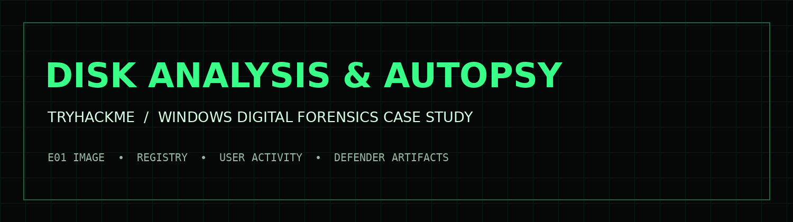

# Disk Analysis & Autopsy — TryHackMe Forensic Investigation

<p align="center">
  
</p>

<p align="center">
  <a href="https://tryhackme.com/">
    
  </a>
  
  
  
</p>

<p align="center">
  
  
  
  
</p>

---

## Overview

This repository documents a Windows digital-forensics investigation performed against the **Disk Analysis & Autopsy** TryHackMe challenge. The supplied evidence is an E01 forensic image named `HASAN2.E01`, examined using **Autopsy 4.18.0**.

The investigation correlates file-system artifacts, Windows registry hives, user-profile data, browser artifacts, PowerShell command history, Windows Defender detection history, and recovered security-tool files. The findings answer the challenge's 15 investigation questions while distinguishing direct artifact observations from analyst interpretation.

> **Purpose:** Demonstrate forensic image handling, Autopsy artifact review, Windows registry analysis, user activity reconstruction, browser artifact examination, endpoint security log review, and evidence-based reporting.

## Investigation Objectives

- Record the forensic container metadata and image hash.
- Identify the Windows host and human user accounts.
- Determine the most recently accessed user account from the Autopsy account artifact.
- Recover the system's network configuration from secondary artifacts when the registry's DHCP address is not useful.
- Identify the network adapter and installed network-monitoring software.
- Review browser bookmarks and user wallpaper evidence.
- Reconstruct a user's PowerShell activity without publishing challenge flag values.
- Identify password-focused tools, inspect a YARA rule, and locate evidence of a Zerologon archive.

## Skills Demonstrated

| Domain | Evidence-backed work |
| --- | --- |
| Forensic Acquisition Review | E01 container metadata, acquisition details, image hashes |
| Windows Forensics | Windows 10 20H1 operating-system artifacts |
| Registry Analysis | SYSTEM network-interface keys; SOFTWARE NetworkCards; NTUSER.DAT wallpaper references |
| User Activity Analysis | User account enumeration, Date Accessed comparison, desktop and download artifacts |
| Network Artifact Analysis | Look@LAN configuration, LANIP and LANNIC values, network adapter identification |
| Browser Forensics | Web Bookmarks artifact and Google Maps URL |
| PowerShell Forensics | PSReadLine `ConsoleHost_history.txt` review |
| Endpoint Detection Artifacts | Windows Defender DetectionHistory review |
| Malware / Tool Artifact Triage | Mimikatz and LaZagne indicators; YARA rule author metadata |
| Deleted Artifact Discovery | Keyword-search hit for a Zerologon archive with deleted-file context |
| Technical Reporting | Evidence mapping, cautious interpretation, limitations, and remediation |

## Lab Information

| Property | Value |
| --- | --- |
| Platform | TryHackMe |
| Room | Disk Analysis & Autopsy |
| Difficulty | Medium |
| Operating System | Windows 10 20H1 (as shown in acquisition information) |
| Forensic Tool | Autopsy 4.18.0 |
| Evidence Image | `HASAN2.E01` |
| Image Type | E01 |
| Image Size | 65.43 GB |
| Sector Size | 512 bytes |
| Acquisition Date | 8 February 2021, 12:40:23 |
| System Date | 8 February 2021, 12:40:23 |
| Time Zone | America/New_York |
| Assessment Type | Authorized digital-forensics training exercise |

## Evidence Sources and Methodology

The investigation uses Autopsy's extracted-content result categories, registry hive viewers, file-system browser, keyword search, and file search by attributes. Rather than relying on a single artifact, several answers are correlated across sources. For example, the network adapter address and IP address are recovered from the Look@LAN configuration, while the registry is separately examined for adapter identity and DHCP configuration.

## Investigation Workflow

```text
E01 Image Review
       |
       v
Container Metadata and Hashes
       |
       v
Operating System Identification
       |
       v
User Account Enumeration
       |
       v
Registry and Network Configuration
       |
       +----> Look@LAN Program and INI
       |
       +----> Network Adapter Registry Key
       |
       v
Browser Bookmark Analysis
       |
       v
User Profile / Wallpaper Review
       |
       v
Desktop File and PowerShell History
       |
       v
PowerShell Script Review
       |
       v
Downloads and Windows Defender History
       |
       v
YARA Rule and Deleted Zerologon Archive
       |
       v
Findings, Timeline Context, and Recommendations
```

## Findings at a Glance

| Question | Result |
| --- | --- |
| Q1 — E01 MD5 | `3f08c518adb3b5c1359849657a9b2079` |
| Q2 — Computer account name | `DESKTOP-0R59DJ3` |
| Q3 — Human user accounts | Eight accounts; listed in the technical walkthrough |
| Q4 — Last accessed user | `sivapriya` |
| Q5 — IP address | `192.168.130.216` |
| Q6 — MAC address | `08-00-27-2c-c4-b9` |
| Q7 — Network adapter | `Intel(R) PRO/1000 MT Desktop Adapter` |
| Q8 — Network monitoring tool | `Look@LAN` |
| Q9 — Bookmarked coordinates | `12°52'23.0"N 80°13'25.0"E` |
| Q10 — Wallpaper full name | `Anto Joshwa` |
| Q11 — First flag | `[FLAG REDACTED]` |
| Q12 — Script message flag | `[FLAG REDACTED]` |
| Q13 — Password tools | `LaZagne`, `Mimikatz` |
| Q14 — YARA author | `Benjamin DELPY (gentilkiwi)` |
| Q15 — Zerologon archive | `2.2.0 20200918 Zerologon encrypted.zip` |

> **Flag protection:** The two flag values from the lab material are redacted in all public-facing documentation and in the corresponding PowerShell evidence screenshots.

## Documentation

- [Complete forensic walkthrough](Documentation/THM_Disk_Analysis_Autopsy_Documentation.md)
- [GitHub Pages case study](https://anurag-rvnkr1.github.io/Disk-Analysis-Autopsy-TryHackMe-Walkthrough/)
- [Investigation notes](Resources/notes.md)
- [Artifact reference](Resources/artifacts.md)
- [Tool reference](Resources/tools.md)
- [Security observations and recommendations](Resources/remediation.md)
- [References and attribution](Resources/references.md)

## Repository Structure

```text
Disk-Analysis-Autopsy-TryHackMe-Walkthrough/
├── README.md
├── _config.yml
├── .github/
│   └── workflows/
│       └── pages.yml
├── Documentation/
│   └── THM_Disk_Analysis_Autopsy_Documentation.md
├── Resources/
│   ├── notes.md
│   ├── artifacts.md
│   ├── references.md
│   ├── remediation.md
│   └── tools.md
├── Screenshots/
│   └── figure-1 through figure-20
├── _layouts/
│   └── default.html
└── docs/
    ├── _config.yml
    ├── index.md
    ├── _layouts/
    │   └── default.html
    └── assets/
        ├── banner.png
        ├── css/
        │   ├── custom.css
        │   └── custom.scss
        └── figure-1 through figure-20
```

## Flag Policy

The original challenge contains two flag values. They are intentionally not included in the public write-up. The related screenshots have been redacted over the flag strings only; the surrounding command history and artifact context remain available.

## Responsible Use

This repository documents offline analysis of a provided TryHackMe forensic image. Findings and tool references are shared for authorized training, forensic education, and defensive security research. Do not use recovered exploit-tool artifacts to access systems without explicit authorization.

---

<p align="center">
  <strong>CYBERSECURITY CTF PORTFOLIO</strong><br>
  Investigate • Correlate • Validate • Report
</p>
