## Quick Overview

<div class="ctf-card-grid">

<div class="ctf-card">
<div class="ctf-card-title">Platform</div>
<div class="ctf-card-value">TryHackMe</div>
</div>

<div class="ctf-card">
<div class="ctf-card-title">Room</div>
<div class="ctf-card-value">Disk Analysis & Autopsy</div>
</div>

<div class="ctf-card">
<div class="ctf-card-title">Difficulty</div>
<div class="ctf-card-value">Medium</div>
</div>

<div class="ctf-card">
<div class="ctf-card-title">Operating System</div>
<div class="ctf-card-value">Windows 10 20H1</div>
</div>

<div class="ctf-card">
<div class="ctf-card-title">Evidence Image</div>
<div class="ctf-card-value">HASAN2.E01</div>
</div>

<div class="ctf-card">
<div class="ctf-card-title">Forensic Application</div>
<div class="ctf-card-value">Autopsy 4.18.0</div>
</div>

<div class="ctf-card">
<div class="ctf-card-title">Image Size</div>
<div class="ctf-card-value">65.43 GB</div>
</div>

<div class="ctf-card">
<div class="ctf-card-title">Outcome</div>
<div class="ctf-card-value">15 Artifact Questions Documented</div>
</div>

</div>

---

## Navigation

<div class="ctf-toc">

<div class="ctf-toc-title">Investigation Navigation</div>
<ul>
<li><a href="#executive-summary">Executive Summary</a></li>
<li><a href="#1-e01-image-metadata">E01 Image Metadata</a></li>
<li><a href="#2-operating-system-and-host">Operating System and Host</a></li>
<li><a href="#3-user-account-enumeration">User Accounts</a></li>
<li><a href="#4-last-accessed-user">Last Accessed User</a></li>
<li><a href="#5-network-configuration">Network Configuration</a></li>
<li><a href="#6-network-adapter">Network Adapter</a></li>
<li><a href="#7-installed-monitoring-software">Installed Monitoring Software</a></li>
<li><a href="#8-browser-bookmark">Browser Bookmark</a></li>
<li><a href="#9-wallpaper-attribution">Wallpaper Attribution</a></li>
<li><a href="#10-powershell-user-activity">PowerShell User Activity</a></li>
<li><a href="#11-script-analysis">PowerShell Script Analysis</a></li>
<li><a href="#12-password-tool-artifacts">Password Tool Artifacts</a></li>
<li><a href="#13-yara-rule-author">YARA Rule Author</a></li>
<li><a href="#14-zerologon-archive">Zerologon Archive</a></li>
<li><a href="#findings-summary">Findings Summary</a></li>
<li><a href="#defensive-recommendations">Defensive Recommendations</a></li>
<li><a href="#lessons-learned">Lessons Learned</a></li>
</ul>

</div>

---

## Executive Summary

The examination of `HASAN2.E01` identified a Windows 10 20H1 host named `DESKTOP-0R59DJ3` and eight human user accounts. Autopsy's user-account results placed `sivapriya` first when sorted by Date Accessed.

Network details were recovered through a combination of registry analysis and the Look@LAN configuration file. Browser, user-profile, desktop, and PowerShell artifacts provided evidence of saved locations, wallpaper configuration, and file modifications. Windows Defender detection history identified a LaZagne path, while a separate download artifact showed a Mimikatz archive. A recovered YARA rule exposed author metadata, and keyword search located a Zerologon-named archive in a user download path.

> **Evidence integrity:** Both challenge flag values are redacted. The report distinguishes artifact presence from proof of execution and does not claim that the password tools or Zerologon archive were executed.

---

## Assessment Methodology

```text
E01 Container Review
       |
       v
Host and OS Identification
       |
       v
User Account Review
       |
       v
Registry and Network Artifacts
       |
       +----> Look@LAN INI
       |
       +----> NetworkCards Registry Key
       |
       v
Browser and Wallpaper Artifacts
       |
       v
Desktop and PowerShell Artifacts
       |
       v
Downloads and Defender History
       |
       v
YARA and Zerologon Search
       |
       v
Findings and Defensive Analysis
```

---

# 1. E01 Image Metadata

The case image was reviewed in Autopsy's data-source Container summary. The display shows an E01 image named `HASAN2.E01`, with a size of 65.43 GB and a sector size of 512 bytes.

<p align="center">
  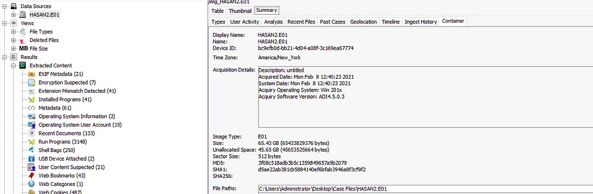
</p>

<p align="center">
  <b>Figure 01.</b> Forensic container metadata and the MD5 value displayed by Autopsy.
</p>

**MD5 displayed:** `3f08c518adb3b5c1359849657a9b2079`

The hash is transcribed from the screenshot and was not independently recomputed in this task.

---

# 2. Operating System and Host

Autopsy's Operating System Information results identify the machine name.

<p align="center">
  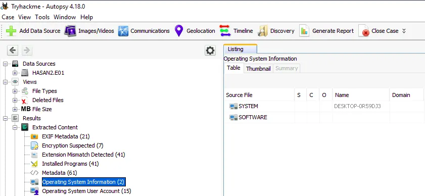
</p>

<p align="center">
  <b>Figure 02.</b> Host name extracted from the Windows registry data.
</p>

**Computer name:** `DESKTOP-0R59DJ3`

The acquisition information identifies the operating-system context as Windows 10 20H1.

---

# 3. User Account Enumeration

The Operating System User Account results were reviewed to identify human user identities and exclude built-in or service accounts.

<p align="center">
  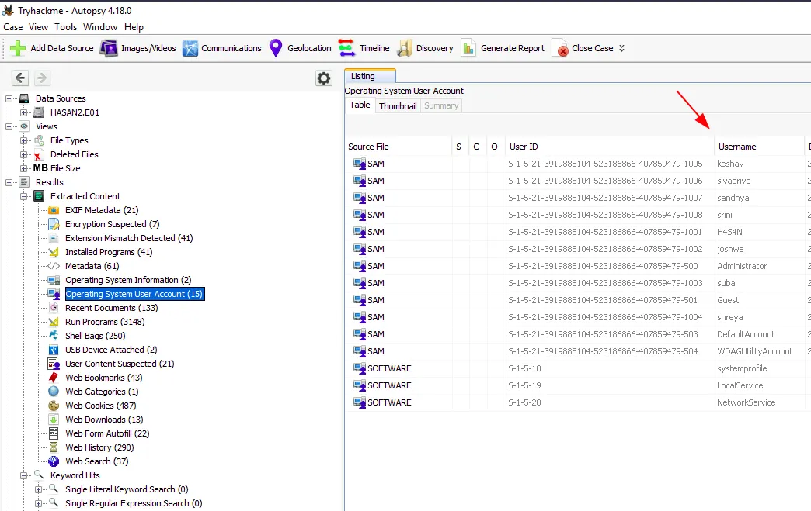
</p>

<p align="center">
  <b>Figure 03.</b> User account records extracted from the SAM and SOFTWARE sources.
</p>

**Human accounts, alphabetically:**

```text
H4S4N
joshwa
keshav
sandhya
shreya
sivapriya
srini
suba
```

The Autopsy output also includes built-in identities such as Administrator, Guest, DefaultAccount, LocalService, and NetworkService. These are not part of the requested human-user list.

---

# 4. Last Accessed User

The account table was sorted by Date Accessed.

<p align="center">
  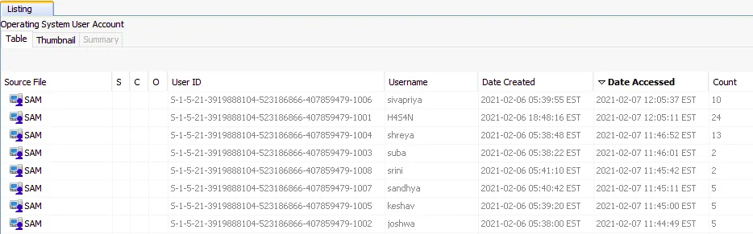
</p>

<p align="center">
  <b>Figure 04.</b> The Date Accessed column places sivapriya first.
</p>

**Last accessed user in the sorted result:** `sivapriya`

This is the answer based on the Autopsy account artifact's Date Accessed field, not a substitute for a complete Windows logon timeline.

---

# 5. Network Configuration

The SYSTEM hive interface key was reviewed first. Its displayed `DhcpIPAddress` value was `0.0.0.0`, so a secondary artifact was used.

<p align="center">
  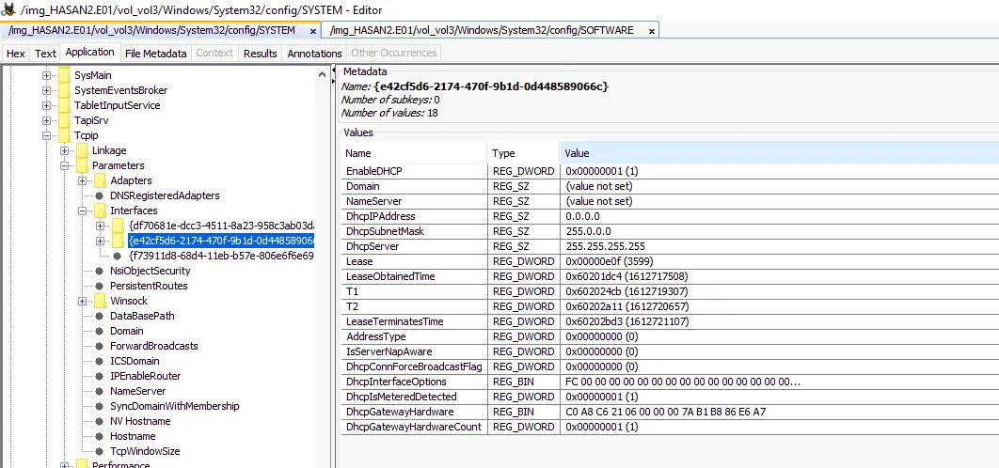
</p>

<p align="center">
  <b>Figure 05.</b> Registry interface values showing an unusable DHCP address in this view.
</p>

Look@LAN was identified in the Installed Programs results. Its `irunin.ini` file under `Program Files (x86)\Look@LAN` was then examined.

<p align="center">
  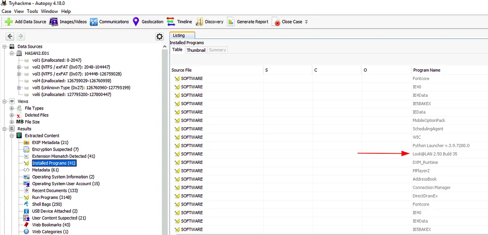
</p>

<p align="center">
  <b>Figure 06.</b> Look@LAN identified in the installed application inventory.
</p>

<p align="center">
  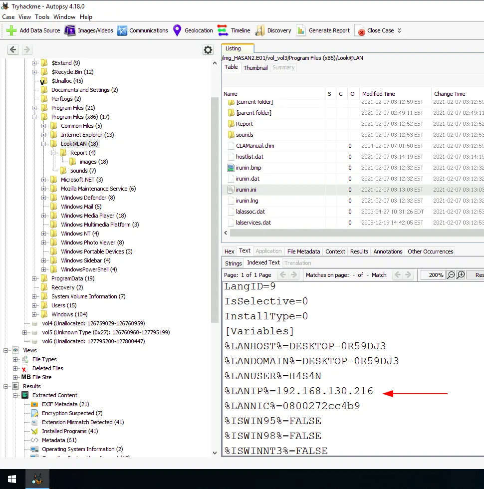
</p>

<p align="center">
  <b>Figure 07.</b> Look@LAN INI values, including LANIP.
</p>

The configuration shows:

```text
%LANHOST%=DESKTOP-0R59DJ3
%LANDOMAIN%=DESKTOP-0R59DJ3
%LANUSER%=H4S4N
%LANIP%=192.168.130.216
```

**IP address recorded by Look@LAN:** `192.168.130.216`

---

# 6. Network Adapter

The Look@LAN INI also contains the interface field `LANNIC`.

<p align="center">
  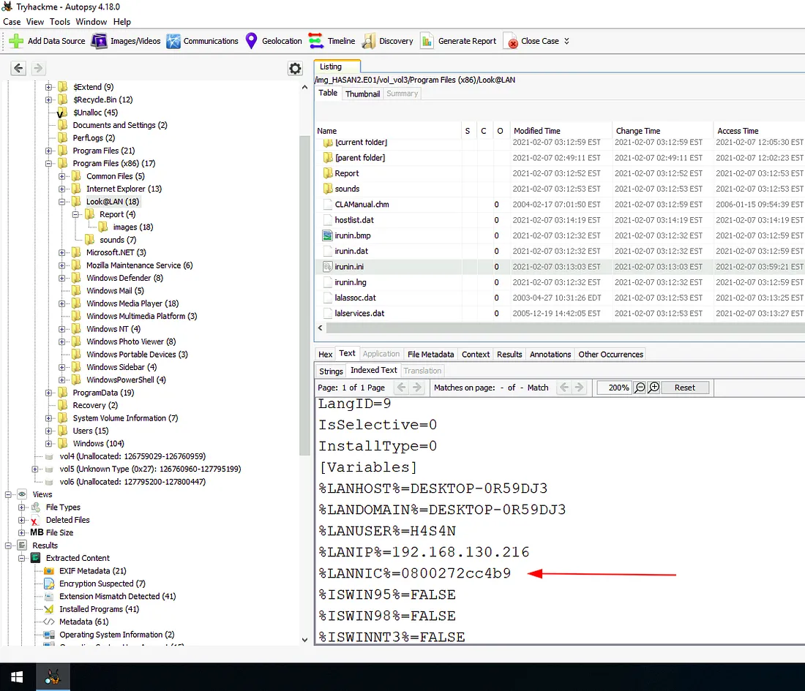
</p>

<p align="center">
  <b>Figure 08.</b> LANNIC field in the Look@LAN configuration.
</p>

The value `0800272cc4b9` is formatted as:

**MAC address:** `08-00-27-2c-c4-b9`

The adapter model was recovered separately from:

```text
SOFTWARE\Microsoft\Windows NT\CurrentVersion\NetworkCards
```

<p align="center">
  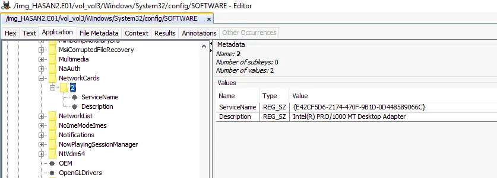
</p>

<p align="center">
  <b>Figure 09.</b> Network adapter description from the SOFTWARE hive.
</p>

**Network card:** `Intel(R) PRO/1000 MT Desktop Adapter`

---

# 7. Installed Monitoring Software

Autopsy's Installed Programs result contains the network monitoring program:

**Application:** `Look@LAN`

The same application's folder provided the INI configuration used to recover the LAN IP and interface address. Figure 06 shows the installed-program result.

---

# 8. Browser Bookmark

The Web Bookmarks extracted-content result was reviewed for the Google Maps bookmark.

<p align="center">
  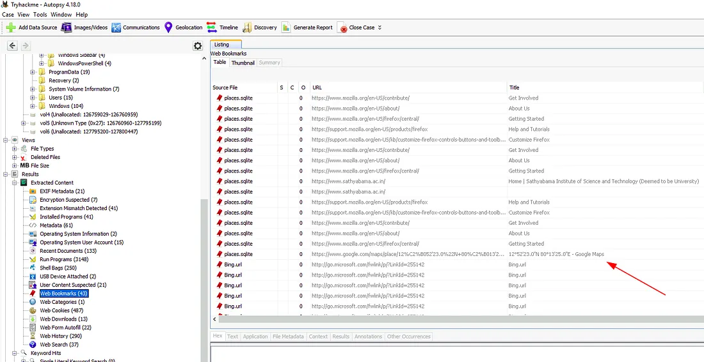
</p>

<p align="center">
  <b>Figure 10.</b> Google Maps bookmark in the browser artifact results.
</p>

**Coordinates:** `12°52'23.0"N 80°13'25.0"E`

The bookmark establishes a saved location URL; it does not establish that the user physically visited the location.

---

# 9. Wallpaper Attribution

The `NTUSER.DAT` Desktop personalization settings were reviewed to identify the image referenced by each profile's Wallpaper value.

The H4S4N profile's wallpaper did not provide the requested name. The Joshwa profile referenced a different image.

<p align="center">
  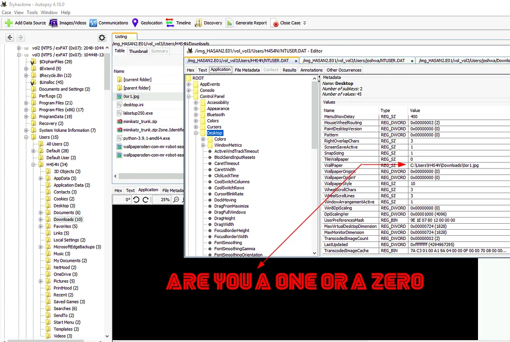
</p>

<p align="center">
  <b>Figure 11.</b> H4S4N wallpaper investigation; no matching full name appears in the referenced image.
</p>

<p align="center">
  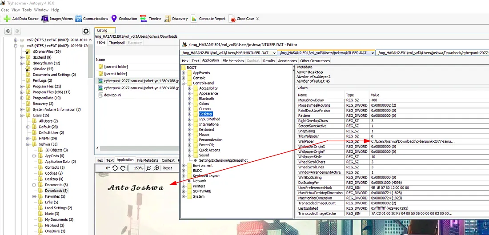
</p>

<p align="center">
  <b>Figure 12.</b> Joshwa wallpaper evidence showing the name.
</p>

**Full name displayed:** `Anto Joshwa`

The attribution is based on the wallpaper path in the Joshwa profile hive and the contents of the referenced image.

---

# 10. PowerShell User Activity

The shreya Desktop contains `shreya.txt` and `exploit.ps1`.

<p align="center">
  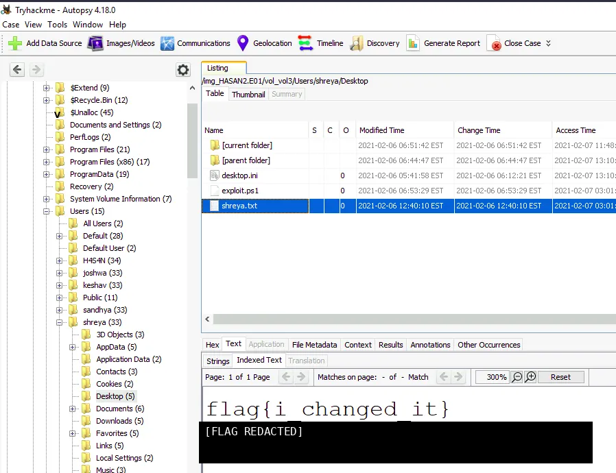
</p>

<p align="center">
  <b>Figure 13.</b> Shreya Desktop artifacts; the flag string is redacted.
</p>

The related PSReadLine history is stored at:

```text
AppData\Roaming\Microsoft\Windows\PowerShell\PSReadLine\ConsoleHost_history.txt
```

<p align="center">
  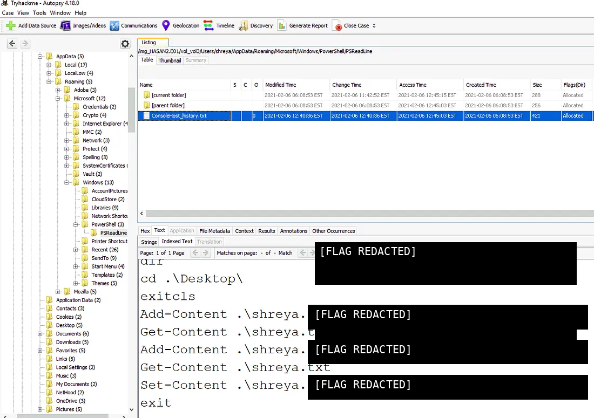
</p>

<p align="center">
  <b>Figure 14.</b> PowerShell history showing file modification commands. Both flag strings are redacted.
</p>

The visible command history records directory navigation, file listing, append and read operations against `shreya.txt`, and a later replacement of its content.

**Original flag:** `[FLAG REDACTED]`

---

# 11. Script Analysis

The recovered `exploit.ps1` excerpt contains a group-membership condition, a payload placeholder comment, and a command writing to `C:\Users\H4S4N\Desktop\hacked.txt`.

<p align="center">
  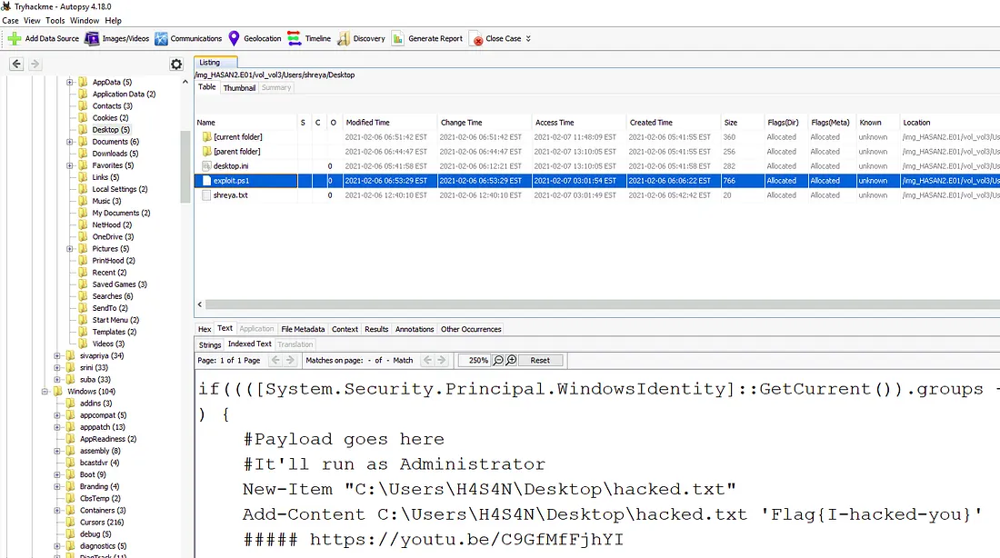
</p>

<p align="center">
  <b>Figure 15.</b> Recovered exploit.ps1 content.
</p>

The visible script includes an intended Administrator execution comment and a file-write action. The supplied screenshot does not establish successful execution or file creation.

**Message in the script:** `[FLAG REDACTED]`

---

# 12. Password Tool Artifacts

The H4S4N Downloads folder contains `mimikatz_trunk.zip`.

<p align="center">
  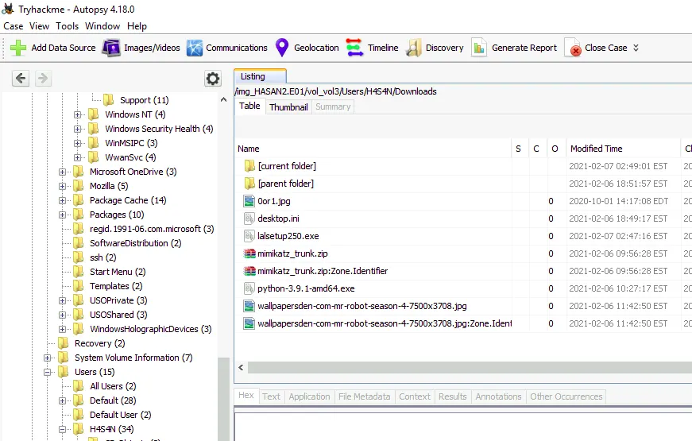
</p>

<p align="center">
  <b>Figure 16.</b> Mimikatz archive in the user download directory.
</p>

Windows Defender DetectionHistory provides the second tool indicator. The selected record references `lazagne.exe`.

<p align="center">
  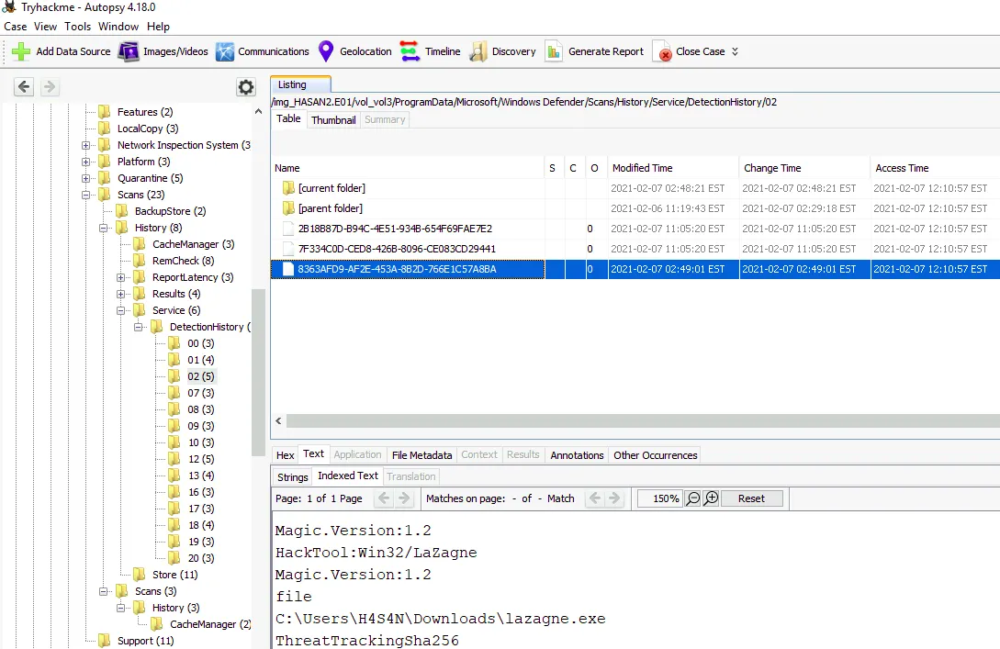
</p>

<p align="center">
  <b>Figure 17.</b> Defender detection artifact referencing LaZagne.
</p>

**Password tools:**
- `LaZagne`
- `Mimikatz`

These artifacts show tool presence or detection; they do not prove successful credential extraction.

---

# 13. YARA Rule Author

Autopsy's File Search by Attributes was configured to locate filenames containing `.yar`.

<p align="center">
  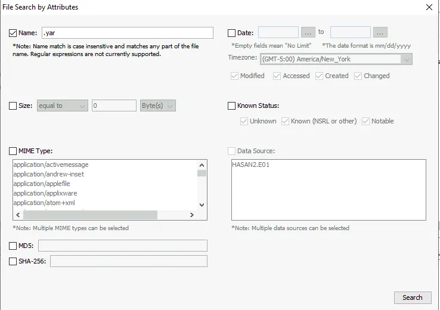
</p>

<p align="center">
  <b>Figure 18.</b> File-name search for YARA rule files.
</p>

The search results include `kiwi_passwords.yar`. Its contents include author metadata.

<p align="center">
  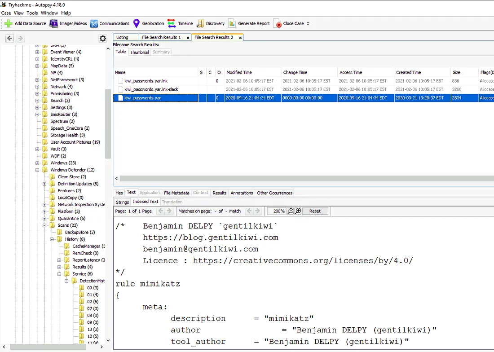
</p>

<p align="center">
  <b>Figure 19.</b> YARA rule author metadata.
</p>

**Author:** `Benjamin DELPY (gentilkiwi)`

---

# 14. Zerologon Archive

A keyword search for `zerologon` returns a hit corresponding to an archive in a Sandhya user download path.

<p align="center">
  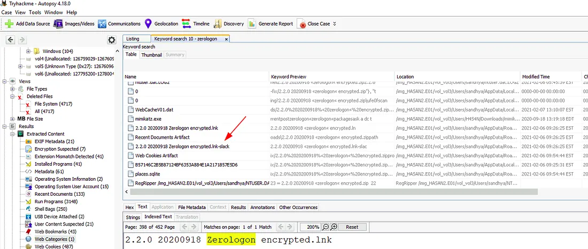
</p>

<p align="center">
  <b>Figure 20.</b> Keyword search result for the Zerologon archive.
</p>

**Archive filename:**

```text
2.2.0 20200918 Zerologon encrypted.zip
```

The source notes describe the archive as deleted. The name and search hit show artifact presence, not execution or successful exploitation.

---

# Findings Summary

| ID | Finding | Evidence |
|---|---|---|
| 01 | E01 MD5 recorded | Container summary |
| 02 | Host name `DESKTOP-0R59DJ3` | OS Information |
| 03 | Eight human users | Operating System User Account |
| 04 | `sivapriya` first by Date Accessed | Sorted account table |
| 05 | `192.168.130.216` | Look@LAN INI |
| 06 | `08-00-27-2c-c4-b9` | Look@LAN LANNIC |
| 07 | Intel PRO/1000 MT adapter | SOFTWARE NetworkCards |
| 08 | Look@LAN installed | Installed Programs |
| 09 | Google Maps coordinates | Web Bookmarks |
| 10 | Anto Joshwa | Joshwa wallpaper evidence |
| 11 | Shreya file modification activity | Desktop and PSReadLine history |
| 12 | PowerShell message-writing script | `exploit.ps1` excerpt |
| 13 | LaZagne and Mimikatz indicators | Defender history and Downloads |
| 14 | Benjamin DELPY (gentilkiwi) | YARA content |
| 15 | Zerologon archive | Keyword search result |

---

# Defensive Recommendations

- Review local user accounts and apply least privilege.
- Enable centralized PowerShell logging and correlate command history with process telemetry.
- Monitor unusual modifications within user profile directories.
- Investigate Defender detections with download and execution evidence.
- Treat credential-tool artifacts and exploit archives as leads requiring corroboration.
- Correlate application-stored network configuration with DHCP and network inventory records.
- Preserve deleted-file metadata and acquisition hashes.
- Normalize timestamps and document the case time zone before building a consolidated timeline.

---

# Lessons Learned

- Validate the evidence container and record its hashes before analysis.
- Correlate registry values with application configuration and filesystem artifacts.
- Distinguish human accounts from service identities.
- Interpret Date Accessed metadata narrowly.
- Link profile registry values to their referenced files before making attribution claims.
- Use PowerShell history, script contents, and execution telemetry as separate evidence sources.
- Review endpoint protection history when file-system browsing alone does not reveal a tool.
- Do not infer execution from file presence, a detection record, or a deleted archive search result.
- Redact challenge flags while retaining sufficient technical context.

---

# Conclusion

The investigation of `HASAN2.E01` demonstrates how Autopsy can correlate Windows registry data, user-profile settings, browser bookmarks, PowerShell artifacts, downloads, and endpoint detection records. By combining multiple artifact sources, the analysis reconstructs host identity, user context, network configuration, and traces of potentially security-relevant activity.

The results are most useful when their evidentiary boundaries are preserved. A stored network address is not a live measurement, a tool download is not proof of execution, and a script excerpt is not proof of successful privilege escalation. The case study therefore records what each artifact demonstrates while identifying where additional corroboration would be needed.

---

# References

- TryHackMe — Disk Analysis & Autopsy.
- Autopsy 4.18.0.
- Sean Dixon, “TryHackMe: Disk Analysis & Autopsy,” Medium, 13 June 2023.

---

# Responsible Use

This repository documents offline forensic analysis of an authorized training image. Recovered exploit-related artifacts are discussed for defensive analysis and education only.
